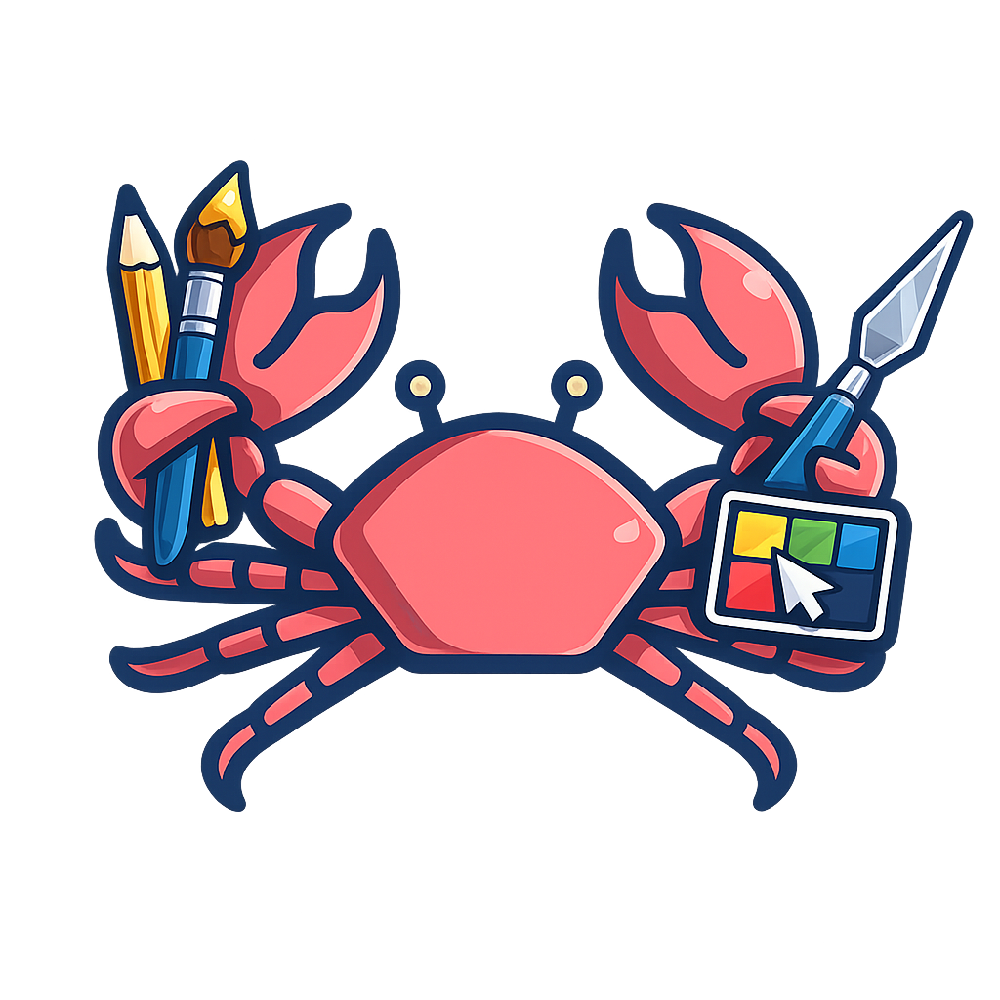

# 🦀 Crabture — Image Annotation & Management

**Crabture** is a powerful, lightweight open-source image editor and management tool designed for fast annotations, screenshots, and bulk file operations on Linux. 

Built with **PyQt6**, Crabture combines a tactile annotation experience with advanced file management features like PowerToys-style bulk renaming and system-wide context menu integration.



## ✨ Features

- **Advanced Annotation Suite:**
  - Tools for `Select`, `Arrow`, `Rectangle`, `Highlight`, `Pixelate`, `Text`, `Crop`, `Magnifier`, and `Speech Balloon`.
  - Layers support: Manage multiple annotation layers with visibility toggle and Z-order control.
  - Rich color palette with alpha (opacity) sliders and custom color picking.
- **Dynamic Image Gallery:**
  - Integrated gallery that monitors your local folders (default: `~/Downloads/Crabshots`).
  - Toggle between List and Grid/Icon views.
  - Instant thumbnail resizing at runtime.
- **⚡ Power Rename (Bulk File Ops):**
  - **Sequential Mode:** Rename groups of files at once using a base name and number padding.
  - **Advanced Mode:** Powerful Search and Replace using **Regular Expressions (RegEx)**.
  - Live preview table with change highlighting before you commit.
- **Aesthetic Unification:**
  - Premium Light and Dark theme modes with a consistent layout.
  - Glassmorphic-inspired UI elements.
- **Linux Native Integration:**
  - "Open with Crabture" entries in GNOME/Nautilus right-click menus.
  - "Open Directory with Crabture" Nautilus script support.
  - Native file manager integration for exploring directories directly from the editor.

## 🚀 Installation

Crabture includes a robust installation script for Debian and other major Linux distributions:

1. Clone the repository to your desired location.
2. Run the install script:
   ```bash
   ./install.sh
   ```
3. (Optional) Add `~/.local/bin` to your `PATH` if it's not already there.

You can now launch Crabture by simply typing `crabture` in your terminal or searching for it in your application menu.

## ⌨️ Shortcuts

| Action | Shortcut |
| :--- | :--- |
| **Open Image** | `Ctrl + O` |
| **Save Image** | `Ctrl + S` |
| **Power Rename** | `Ctrl + R` |
| **Undo / Redo** | `Ctrl + Z` / `Ctrl + Y` |
| **Zoom In / Out** | `Ctrl + =` / `Ctrl + -` |
| **Fit to Window** | `Ctrl + 0` |
| **Delete Selected Item** | `Delete` |
| **Copy Canvas to Clipboard** | `Ctrl + Shift + C` |

## 🛠 Prerequisites

- Python 3.10+
- PyQt6 (`pip install PyQt6`)

---

Developed with ❤️ as part of the YawnByte project suite.
